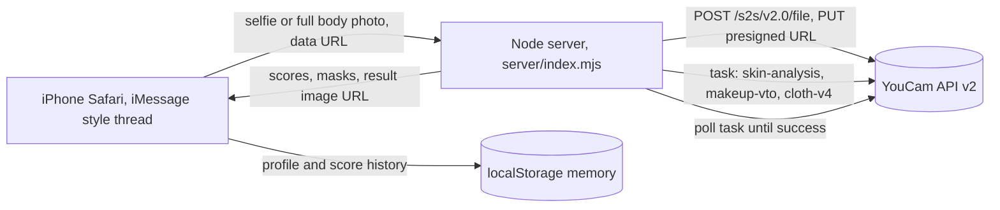

# Mira: your AI beauty and style assistant in iMessage

Mira is a shopping assistant you text like a friend. Send one selfie and Mira reads your skin with **YouCam AI Skin Analysis**, matches products to your three weakest scores, checks three stores for the best price, and then tries the best lip shade on your own face with **YouCam Makeup VTO** before you ask. Ask for a full look and Mira dresses your full body photo with **YouCam AI Clothes**. Everything happens inside an iMessage style thread that runs on iPhone Safari (add it to the home screen for a full screen app) and on desktop inside a phone frame.

Built for the YouCam API Skin AI and eCommerce VTO Hackathon (both tracks: Skin AI and eCommerce VTO, working as one flow).

## Why it matters

People wonder about their skin right before a purchase, not in the abstract. Today that moment means a quiz, a guess, a serum that breaks you out, a lipstick that looked better on the model, and paying full price at the first store. Mira turns that moment into one text message: a measured skin read, products chosen for the measured problem, the shade already on your face, and the cheapest verified seller.

## What the agent does on one selfie

| Step | Tool | What the user sees |
| :--- | :--- | :--- |
| 1 | Client resize to YouCam limits | "Reading your selfie" |
| 2 | YouCam Skin Analysis (`/s2s/v2.0/task/skin-analysis`, 8 SD concerns, JSON output with masks) | Skin score ring, skin age, 8 concern bars, concern heat maps |
| 3 | Product matcher (lowest three scores mapped to actives) | Archi style product cards with review pills and sources |
| 4 | Price check across three stores | "better price found" tags and total saved |
| 5 | YouCam Makeup VTO (`/s2s/v2.0/task/makeup-vto`, `lip_color` effect chosen from the redness score) | Before and after slider of the shade on your face |
| 6 | Memory update (localStorage) | "Mira remembers" card: skin type, focus, shade, score history |

The step trace is streamed into the thread so the user can watch the agent work, and every step can fail independently with a friendly, specific message (face too small, too dark, not front facing, timeout, offline). A Stop button aborts an in flight scan.

Outfits follow the same pattern with YouCam AI Clothes (`/s2s/v2.0/task/cloth-v4`, with an automatic fallback to the v2 `cloth` endpoint).

## Run it

```bash
cp .env.example .env
```

Put your key from the YouCam API console into `.env` as `YOUCAM_API_KEY=...`. Without a key the server runs in demo mode with deterministic mock scores so the UI can still be explored.

```bash
npm --prefix web install
```

```bash
npm run build && npm start
```

Open http://localhost:8787 for the landing page and http://localhost:8787/#/chat for the iMessage thread. For development run `node server/index.mjs` and `npm --prefix web run dev`, then open http://localhost:5173 (Vite proxies `/api` to the server).

## Architecture



The YouCam key never reaches the browser. `server/youcam.mjs` implements the documented v2 flow (register file, PUT bytes to the presigned URL, create task, poll every 2 s up to 120 s) and normalises the different result shapes the docs describe (`results.url`, `results[].download_url`, region split skin scores, `skin_age` rows).

| Path | Purpose |
| :--- | :--- |
| `server/youcam.mjs` | YouCam v2 client: upload, task, poll, result parsing |
| `server/index.mjs` | `/api/skin`, `/api/makeup`, `/api/cloth`, demo mode, static hosting |
| `web/src/chat/useMira.ts` | The agent: intents, tool chain, step trace, memory |
| `web/src/chat/Chat.tsx` | iMessage UI: bubbles, cards, before and after slider, photo sheet |
| `web/src/landing/Landing.tsx` | Marketing page |
| `web/src/data/catalog.ts` | Fictional brands, shades, stores and the `lip_color` effect builder |

## Notes and limitations

Brands, stores and prices are fictional so the demo carries no third party trademarks; a production build would plug a real catalog and price feed into `catalog.ts`. Demo photos in `web/public/samples` are YouCam's own documentation sample images. The iMessage experience is a faithful web rendition so judges can open it on any iPhone without an Apple Business Chat account; the same agent could sit behind an iMessage relay (for example Business Chat) unchanged because all state lives in the agent hook and the server API.
